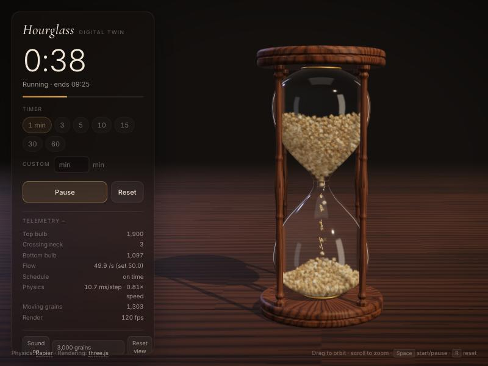

# Hourglass: a digital twin

**▶ Try it: [khanmjk.github.io/HourGlass_Opus55](https://khanmjk.github.io/HourGlass_Opus55/)**. It runs in the browser, with nothing to install.



A 3D hourglass timer where every grain of sand is a rigid body in a real
physics engine. Pick a duration, press **Start**, and the sand drains through
the neck at a steady rate, carving a crater in the top bulb and piling into a
cone in the bottom one. The top bulb empties when the time is up. When it's
done, **Flip & start** turns the glass over: the sand tumbles to the other end
under simulated gravity, and the timer runs again.

## Features

- **Real granular physics.** 3,000 grains (2,000 or 4,500 selectable), each a
  rigid body with gravity, friction and rolling resistance. The sand forms a
  crater above the neck and a cone at the angle of repose below it.
- **Timing that holds.** The neck meters sand at exactly N grains in T
  seconds, the way a real orifice does. In tests the top bulb empties within
  25–50 ms of the set time.
- **Durations:** 1, 3, 5, 10, 15, 30 and 60 minutes, or any custom whole
  number of minutes from 1 to 180.
- **Physical flip.** After a run, the glass is lifted and turned over, and the
  sand slides to the other end under simulated gravity.
- **Live telemetry:** grains in each bulb, measured flow against the set rate,
  schedule accuracy, and the physics cost per step.
- **Sound:** a synthesised sand hiss while it flows and a bell when time is up.
- **Works on desktop and phone** layouts.

## Using it

| | |
|---|---|
| Timer chips / Custom | 1, 3, 5, 10, 15, 30 or 60 minutes, or any whole number of minutes from 1 to 180 |
| **Start** | Opens the neck and starts the countdown |
| **Pause / Resume** | Closes the neck. Sand already falling keeps falling, and the clock stops. |
| **Flip & start** | After a run, turns the glass over and runs again |
| **Reset** | Stands the glass upright and puts all the sand back in the top bulb |
| Drag / scroll | Orbit and zoom (`V` resets the view) |
| Keys | `Space` start/pause/resume, `R` reset |
| Grains | 2,000 (light), 3,000 (default) or 4,500 (needs a fast CPU) |

The **Telemetry** panel shows grains in each bulb, the measured flow rate
against the set rate, whether the release schedule is on time, the physics
cost per step and whether the simulation is keeping up with real time. If the
simulation runs below real time on your machine, choose 2,000 grains.

It needs a current browser with WebGL 2 and WebAssembly SIMD: Chrome, Edge,
Firefox, or Safari 16.4 or later.

## Run it locally

```bash
git clone https://github.com/khanmjk/HourGlass_Opus55.git
cd HourGlass_Opus55
npm install
npm run dev
```

Then open http://localhost:5173.

`npm run build` writes a static site to `dist/`, which works from any static
file server and under any sub-path.

## Deployment

Every push to `main` is built and published to GitHub Pages by
[`.github/workflows/deploy.yml`](.github/workflows/deploy.yml). To host your
own copy from a fork, go to **Settings → Pages → Source** and choose
**GitHub Actions**.

## Built with

- **Physics:** [Rapier](https://rapier.rs) 0.21 (Rust compiled to WebAssembly, SIMD build), running in a Web Worker
- **Rendering:** [three.js](https://threejs.org) r186 (physically based materials, refractive glass, soft shadows)
- **Build:** [Vite](https://vite.dev)

## How it works

### The sand obeys real physics

Each grain is a Rapier rigid-body sphere: gravity at 981 cm/s², friction,
restitution, and rolling resistance (angular damping). The glass is a static
triangle mesh made from the same surface of revolution that is drawn on
screen. A few things make it behave like sand rather than marbles:

- **Contact stiffness.** Rapier's default contact softness is tuned for
  metre-sized objects. With 3 mm grains it let a deep pile compress by about
  19%, so contacts are stiffened. The grains now overlap by about 2%.
- **Rolling damping.** Locking grain rotation made arches over the neck too
  stable. Free spheres with damped rolling give a natural angle of repose
  (about 30–35°) and arches that break the way dry sand does.
- **Containment.** A signed-distance field of the glass backs up the triangle
  mesh, so a grain at the bottom of a deep pile can't be squeezed through the
  thin shell.

### Why the timing is exact

A real hourglass keeps time because flow through an orifice is constant: it
depends on the size of the hole, not on how much sand is above it
(Beverloo's law). The digital twin sets the rate at the neck in the same way.
A thin diaphragm closes the orifice, and a metering gate lets grains through
on a wall-clock schedule:

    released(t) = floor(N × t / T)

The gate always takes the grain sitting lowest in the orifice. That grain
stops colliding with the diaphragm and with the sand it is leaving, slides
down the funnel, drops through the neck under gravity, and becomes ordinary
sand again in the bottom bulb. No grain is ever teleported. The grains around
it fall into the gap it leaves, which is what forms the crater above.

The physics worker is the only clock. The countdown on screen, the release
schedule and the "time's up" chime all come from it, so the display and the
sand can't drift apart. If a slow machine can't simulate in real time, the
sand moves in slow motion while the schedule stays tied to wall-clock time.

### Keeping 3,000 rigid bodies fast

Most of the sand is still at any moment. A freeze manager switches grains at
rest to fixed bodies and thaws them as soon as something near them moves.
That covers a grain leaving from below, a grain landing nearby, or a slope
steeper than sand can hold. The solver therefore spends its time on the grains
that are actually flowing. During a flip, every grain moves at once, so grain
rotation is locked to keep that phase affordable.

### Rendering

- Each physics grain is drawn as a cluster of six faceted sub-grains that
  turns with the body, so 3,000 simulated grains look like about 18,000.
- **Fine stream.** A real 60-minute glass moves millions of grains, so its
  stream looks continuous. The simulated grains pass only about once a second
  at that rate. A thread of fine sand is drawn from the orifice to the top of
  the pile using ballistic free fall, which is the exact physics for grains in
  a dilute falling stream. It lands wherever the simulated pile currently is.
- The glass is a physically based transmissive material lit by a procedural
  studio environment. The caps and spindles are turned walnut with procedural
  wood textures, and there are no image assets.

## Verifying the timing

```bash
npm run verify                            # 60 s timer, 3,000 grains
node scripts/verify-timing.mjs 300        # 5 minutes
node scripts/verify-timing.mjs 60 4500    # 60 s, 4,500 grains
```

The verify script runs the real simulation headlessly. It settles the sand,
runs the timer, flips the glass, runs it again, and reports when the top bulb
actually emptied. Results from development (Apple Silicon, Node 22):

| Timer | Grains | Top bulb emptied (run 1 / after flip) | Max lag behind schedule |
|---|---|---|---|
| 30 s | 3,000 | +42 ms / +50 ms | 0 grains |
| 60 s | 2,000 | +42 ms / +33 ms | 0 grains |
| 60 s | 3,000 | +33 ms / +25 ms | 0 grains |
| 60 s | 4,500 | +25 ms / +25 ms | 0 grains |
| 5 min | 3,000 | +33 ms | 0 grains |

The remaining few tens of milliseconds are the last grain crossing the neck
after its release at exactly T.

## Limits

- **Grain size.** The grains are about 3.6 mm across, which is coarser than
  real hourglass sand. That is the price of simulating every grain as a rigid
  body in a browser. The six-part clusters and the fine stream make up for it
  visually.
- **Slower machines.** The 1-minute timer is the heaviest load, at about
  8–9 ms per physics step with 3,000 grains. On a slower CPU the simulation
  runs a little below real time. The timing stays exact and the telemetry
  shows the speed. Choose 2,000 grains if that happens.
- **Pausing.** Pause closes the neck, which a real hourglass can't do. The
  physical equivalent is laying the glass on its side.

## Project layout

```
index.html                 UI markup
src/main.js                main thread: UI, worker messages, render loop
src/physics.worker.js      physics thread: Rapier world, timer, flip
src/sim/HourglassSim.js    grains, glass, metering gate, freeze manager
src/sim/profile.js         glass shape, volume and signed-distance field
src/scene/stage.js         renderer, camera, lights, studio environment, table
src/scene/hourglass.js     glass, walnut caps and spindles, brass collars
src/scene/sand.js          grain clusters and the fine stream
src/scene/textures.js      procedural wood textures
src/audio.js               synthesised sand hiss and end-of-timer bell
scripts/verify-timing.mjs  headless timing verification
.github/workflows/         build and deploy to GitHub Pages
```

## Credits

Built with [Claude Code](https://claude.com/claude-code). Physics by
[Rapier](https://rapier.rs) (Apache-2.0) and rendering by
[three.js](https://threejs.org) (MIT).
